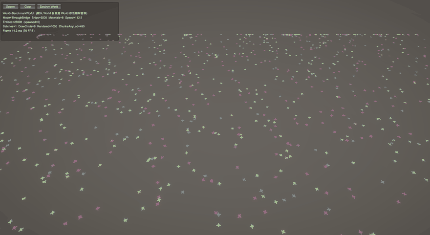

# URPDOTSStudy

Unity DOTS 实验工程：在**保留 GameObject 工作流**的前提下，把渲染与空间查询交给 DOTS。

> 5000 单位实时 benchmark（8 种材质变体）：`Batches=1`、`DrawCmds=8`，约 70 FPS（编辑器）。

## 内容

- **运行时渲染桥**：GameObject 的逻辑 / 层级 / Transform / Collider 全部保留，只把被标记父物体下的 `MeshRenderer` / `LODGroup` 转成 Entities Graphics 实体绘制；父物体变换经 `TransformAccess` 帧初读入、帧末回写。
- **合批 benchmark**：1000 单位、8 种材质变体 → Frame Debugger 中合为 **1 个 Hybrid Batch Group、8 个 DrawCall**。
- **空间索引**：四叉树 / 八叉树合一，支持 Bulk 与 Incremental 两种更新。
- **A\* 寻路 + ORCA 局部避障**：均为 DOTS 重写，邻居查询可来自空间索引。
- **CustomLit 着色器**：自发光、轮廓光、溶解、模型影子/裁切/流光等效果。

## 环境

| 依赖 | 版本 |
|---|---|
| Unity | 2022.3.62f3c1 |
| Entities | 1.4.7 |
| Entities Graphics | 1.4.20 |
| Burst | 1.8.29 |
| URP | 14 |

## 运行

1. 用 Unity Hub 打开本目录；
2. 打开 `Assets/Scenes/SampleScene.unity`，Play；
3. 场景里的 `ZZBENCH_Suite` 调参后点 **Spawn**，用 Frame Debugger / Entities Graphics Stats 观察合批效果。

## 目录

- `Assets/Scripts/DOTSUtils/Runtime` —— 渲染桥与各 DOTS 模块（Spatial / Rvo / Pathfinding / Visibility / Shaders）
- `Assets/Scripts/DOTSUtils/Samples` —— benchmark 与演示
- `Assets/Scripts/DOTSUtils/Tests` —— EditMode / PlayMode 测试

## 第三方资源

- 飞船模型：[Kenney Space Kit](https://kenney.nl/assets/space-kit)（CC0），许可证见 `Assets/Art/Model/Ship/CC0/README_Kenney_SpaceKit_License.txt`

## License

MIT
